  

  
  
  

## 👋 Namaste!

- 🪄 **5 Line Ka Jaadu**: kaam ki Python tricks, har ek sirf 5 line mein
- 📱 Roz use hone wale apps, bina login aur bina ads
- 🎬 Har trick ka Short YouTube par, Hinglish mein
- ⭐ Kuch kaam ka laga? Repo ko star kar do, bhai ka din ban jayega

## 🎬 Latest on YouTube

<!-- YOUTUBE:START -->
_Channel link coming soon._
<!-- YOUTUBE:END -->

## 🛠️ Projects

<table>
  <tr>
    <td width="50%" valign="top">
      <h3>🌱 <a href="https://github.com/byteBhai/Byte_Bhai_dailyTracker">Daily Hub</a></h3>
      All-in-one Android app: pure-veg diet, gym, steps, money, habits and to-dos. No login, no ads, data stays on your phone.
        
      
      
      
    </td>
    <td width="50%" valign="top">
      <h3>🪄 5 Line Ka Jaadu</h3>
      Chhote Python scripts jo bade kaam karte hain: photo ka background hatao, UPI QR banao, photo ko pencil sketch karo.
        
      
      
    </td>
  </tr>
</table>

## 🧰 Tools

  

## 📊 Live Dashboard

<!-- DASHBOARD:START -->

### 🌍 Log kahan se aaye (14 days)

_Abhi koi data nahi. Pehle visitors aane do_ 🙂

<b>📄 Kaunse pages khule (14 days)</b>

| Page | Views | Unique |
|---|---:|---:|
| _no data yet_ | | |

<b>📦 Har repo ka hisaab</b>

| Repo | ⭐ | 🍴 | 👀 Views (14d) | 🧑 Unique (14d) | 📥 Clones (14d) | 📦 Downloads | 👀 Views since tracking |
|---|---:|---:|---:|---:|---:|---:|---:|
| [Byte_Bhai_dailyTracker](https://github.com/byteBhai/Byte_Bhai_dailyTracker) | 0 | 0 | 0 | 0 | 0 | 0 | 0 |
| [byteBhai](https://github.com/byteBhai/byteBhai) | 0 | 0 | 0 | 0 | 0 | 0 | 0 |

Updated daily by GitHub Actions · last run 2026-11-01 03:15 UTC
<!-- DASHBOARD:END -->
